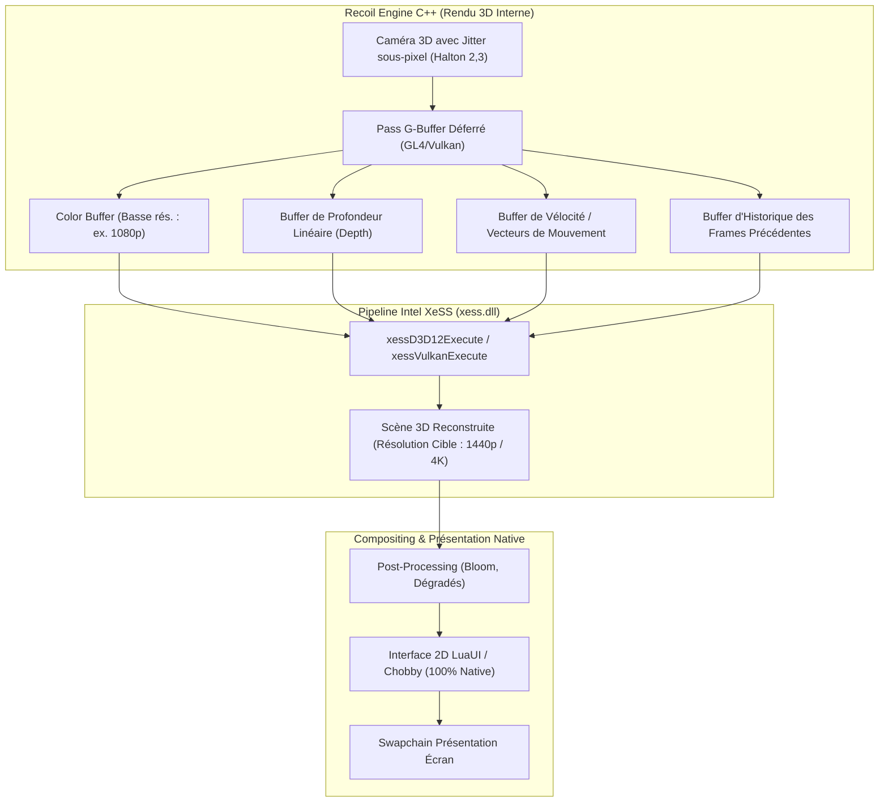

# Intel XeSS (AI Temporal Upscaling) & Render Scale Architecture Specification

> **Avertissement de terminologie (Règle d'or)** :  
> L'upscaling spatial (AMD FidelityFX CAS / RCAS / EASU ou filtrage bilinéaire) est une reconstruction spatiale par sharpening mono-frame, **en aucun cas un upscaler temporel IA**.  
> Le terme **"Intel XeSS"** est exclusivement réservé au pipeline de reconstruction temporelle multi-frames avec vecteurs de mouvement et réseau de neurones. Il ne doit jamais être utilisé pour qualifier une passe spatiale RCAS.

---

## 1. Deux Paliers Distincts

### Palier 3A (Jeu / LuaUI) : Échelle de rendu 3D avec reconstruction spatiale RCAS
- **Implémentation** : `luaui/Widgets/gfx_render_scale.lua` et `luaui/Widgets/gui_options.lua`.
- **Mécanisme** :
  - Rendu de la scène 3D (terrain, unités, projectiles) dans un FBO à résolution réduite (50%, 67%, 77%, 85%).
  - Ré-échantillonnage spatial et sharpening via FidelityFX RCAS / EASU vers la résolution native de l'écran.
  - Rendu direct du HUD 2D (minimap, polices, compteurs de métal/énergie, barres de vie) à **100% de la résolution native**.
- **Compatibilité** : Immédiate sur tous les GPU OpenGL 3.3 / 4.x sans modification du moteur C++.

### Palier 3B (Moteur / C++) : Véritable Intel XeSS Temporel (Étude & Spécification Moteur)
- **Localisation** : Moteur Recoil C++ (`RecoilEngine`), pas dans les scripts Lua de BAR.
- **Mécanisme** : Réseau de neurones alimenté par l'historique temporel, la couleur jitterée, le depth buffer et le velocity buffer (vecteurs de mouvement).

---

## 2. Architecture & Pipeline Temporel (Palier 3B)

---

## 3. Prérequis Techniques Moteur C++

Pour que le XeSS temporel soit opérationnel dans Recoil Engine sans artefacts ni ghosting :

1. **Vecteurs de mouvement (Velocity Buffer)** :
   - Doivent coder le déplacement exact à l'écran de chaque pixel entre $frame_{t-1}$ et $frame_t$.
   - Calculés par le vertex shader des unités animées (matrices d'os / pièces) et du terrain.
2. **Jitter de projection sous-pixel** :
   - Application d'un décalage sub-pixel selon une suite de faible discrépance (Halton 2,3 sur 16 ou 32 phases).
3. **Réinitialisation lors des coupures de caméra** :
   - Flag `XESS_FLAG_EXPOSURE_SCALE_ENABLE` et reset d'historique lors des téléportations ou cuts caméra spectateur.
4. **Interop Graphique** :
   - Recoil étant basé sur OpenGL, le SDK Intel XeSS officiel exige DX11, DX12 ou Vulkan. L'intégration nécessite soit la transition vers le backend Vulkan de Recoil, soit une extension d'interopérabilité `GL_EXT_memory_object` / DX12 shared surface.

---

## 4. Options Graphiques en Jeu (`gui_options.lua`)

Dans `luaui/Widgets/gui_options.lua` :
* Entrée : **"3D Resolution Scaling (RCAS / Spatial)"**
* Options :
  - `100% Native` (Facteur 1.0x)
  - `85% Ultra Quality` (Facteur 0.85x)
  - `77% Quality (+35% GPU)` (Facteur 0.77x)
  - `67% Balanced (+60% GPU)` (Facteur 0.67x)
  - `50% Performance (+100% GPU)` (Facteur 0.50x)
* Description : *"Réduit la résolution de rendu du champ de bataille 3D tout en conservant l'interface 2D, les textes et la minimap à résolution d'écran 100% native. Utilise la reconstruction spatiale FidelityFX RCAS / EASU."*
